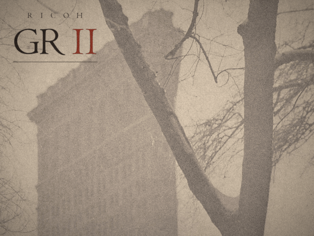

# gr-shutdown

Turns a portrait photo into a 1.2-second power-off animation styled after the Ricoh GR II's
4:3 screen: the photo holds with a "RICOH GR II" lockup in the sky, then fades to black.
Everything, including the wordmark, is drawn in code; no image editor is involved.



<sub>Design v3. Demo photo: Alfred Stieglitz, *The Flatiron*, 1903, The Metropolitan Museum of Art,
Alfred Stieglitz Collection, 1949 (49.55.16). Public domain, released by the Met under
[CC0](https://commons.wikimedia.org/wiki/File:The_Flatiron_MET_DP233039.jpg).</sub>

## Pipeline

```
photo ─► prepare.py ─► typography.py ─► animate.py ─► export.py
         crop + grade   wordmark layers   6 frames      GIF / MP4 / stills / SVG
```

| Stage | File | What it does |
|---|---|---|
| 1 | `src/prepare.py` | Crops the portrait to a 4:3 window that leaves a band of sky for the type, removes coarse grain with a median pass, resizes to 640x480 and 1280x960, and applies a gentle film grade (navy shadows, warm highlights). |
| 2 | `src/typography.py` | Builds the lockup. "RICOH" is tracked to the width of "GR"; the numeral II is two hanging web strands that flare from hairline threads into letter stems, bridged by a sagging strand. Every animatable property lives in one `WordmarkState` dataclass. |
| 3 | `src/animate.py` | Renders 6 frames x 200 ms: two held frames, then a fade to black. |
| 4 | `src/export.py` | Encodes the frames into GIFs (play-once master and looping copies), an H.264 preview and stills, and writes the wordmark as an editable SVG. |

`src/versions.py` defines three designs that share the pipeline. Match the design to the photo:
- **v1, photo-led:** a small grotesk lockup tucked into the sky, top right. The II is two
  hanging web strands.
- **v2, type-led:** "GR II" is the hero, centred and large; RICOH becomes a quiet credit,
  and the big II strands carry suit-style webbing.
- **v3, print-led (the demo):** for monochrome, pictorialist photographs. The lockup is set
  in Centaur, Bruce Rogers' 1914 revival of a 15th-century Venetian roman, in a warm
  black-brown that shares the print's hue but is darker than anything in it. The II is printed in brick
  red, the way Arts & Crafts printers rubricated initials, and a hairline rule underneath
  reads like a plate caption. A photogravure is printed in one ink, so v3 turns off the
  colour misregistration and the glow used by v1 and v2.

## Details worth reading in the code

- **The fade is computed in linear light,** so equal steps read as even dimming on screen
  instead of a sudden drop. Highlights fade slightly later than the rest
  (`k ** (1 - LINGER * luminance)`), the way a screen loses its light.
- **Type is drawn at 4x and box-downsampled,** which gives clean anti-aliasing at both
  output sizes.
- **Print-style misregistration (v1, v2):** each colour plate of the type is offset by a
  fraction of a pixel (red right, blue left) so the lockup sits in the image rather than on
  top of it.
- **One static grain plate** for every frame, so held frames are identical and the GIF only
  stores what changes. Grain strength follows luminance, strongest in the midtones.
- **The SVG is built from the font's real glyph outlines** with fontTools (for v1 and v2,
  `instantiateVariableFont` at weights 700 and 600), so it matches the raster lockup.
- **GIFs use one palette generated from all frames,** with no dithering and only the
  changed rectangle stored per frame, so the fade has no dither noise and the file stays small.

## Run

Requires Python 3.10+ and ffmpeg on `PATH`. Fonts are not included:

| Design | Font | Where to get it | Override |
|---|---|---|---|
| v1, v2 | Bahnschrift (variable) | ships with Windows | `GR2_FONT` |
| v3 | Centaur | ships with Microsoft Office | `GR2_SERIF_FONT` |

A design whose font is missing fails on its own; the others still render.

```bash
pip install -r requirements.txt
cp /path/to/your/photo.png assets/raw/source.png   # or set GR2_SOURCE
python src/export.py        # all versions -> out/, out/v2/, out/v3/
python src/export.py v3     # one version
```

The crop offsets in `src/versions.py` (`crop_y0`) are tuned per photo. To find a good one,
render a few candidates and compare:

```bash
python src/prepare.py 400 520 640   # writes assets/prepared/base_640x480_y<N>.png
python src/export.py --crop-y 520   # then render with the one you like
```

### Reproduce the demo

Download [`The_Flatiron_MET_DP233039.jpg`](https://commons.wikimedia.org/wiki/File:The_Flatiron_MET_DP233039.jpg)
from Wikimedia Commons, trim the paper margin around the printed plate, and render v3 (its
crop is already at the top, so the building's tip stays in frame):

```bash
python -c "from PIL import Image; Image.open('The_Flatiron_MET_DP233039.jpg').convert('RGB').crop((28, 28, 1598, 3150)).save('assets/raw/source.png')"
python src/export.py v3     # docs/demo_v3.gif is out/v3/gr2_v3_shutdown_640x480_loop.gif
```

## Notes

Apart from the demo GIF, no images are included: bring a photo you have the rights
to use. This is an
independent fan project, not affiliated with or endorsed by Ricoh; "RICOH" and "GR" are
Ricoh's trademarks.

## License

The code is released under the [MIT License](LICENSE). It covers the code only: the fonts
keep their own licenses and are not included, and the demo photo is public domain (CC0).
